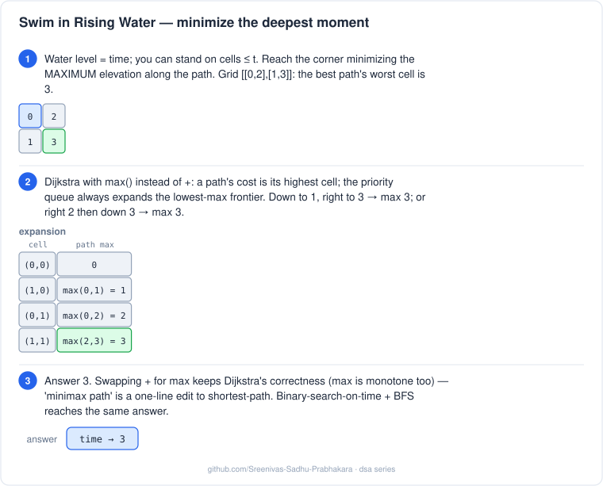

# Swim in Rising Water

> NeetCode 150 · Advanced Graphs — Dijkstra with max instead of plus: a path costs its highest cell, and the greedy settling argument survives the swap. Go, stdlib only, tested.

## Problem

Water rises one unit per time step; a cell is passable once its elevation is submerged. Earliest time to swim from the top-left to the bottom-right = the minimum over paths of the *maximum* elevation along the path.

## Approach

Dijkstra's proof needs path costs that never decrease as a path extends — true for sums of non-negative weights, and equally true for **max** of elevations. So swap the relaxation: a neighbor's candidate cost is `max(current cost, neighbor's height)`, everything else — min-heap frontier, settle-on-pop, visited set — is dsa-165 verbatim. This "minimax path" variant family (bottleneck shortest paths) also admits binary-search-the-answer + BFS reachability and union-find by elevation order; the Dijkstra form generalizes best. The start cell's own height counting is the off-by-one the last test pins.

**Complexity:** O(n² log n) time, O(n²) space.

## Visual walkthrough

Read the picture top to bottom — each numbered frame is one moment of the algorithm
running on this repo's test example.

## Run

    go test ./...   # verify
    go run .        # demo

---

Part of a 275-repo DSA series in Go — Striver's SDE Sheet (dsa-001–191) plus the NeetCode 150 / Blind 75 additions (dsa-192–275), stdlib only, every solution tested. Browse: [`dsa-*` repos](https://github.com/Sreenivas-Sadhu-Prabhakara?tab=repositories&q=dsa-&type=source).
